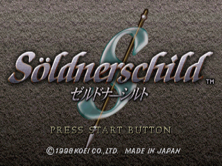
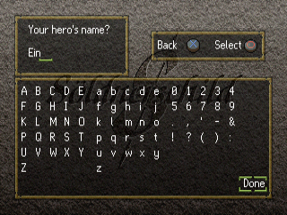
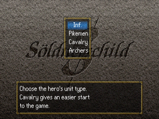
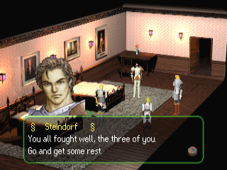
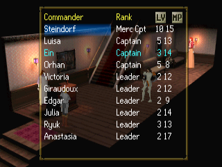
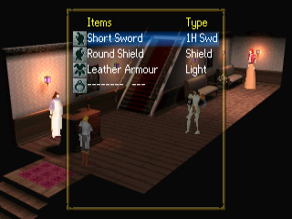
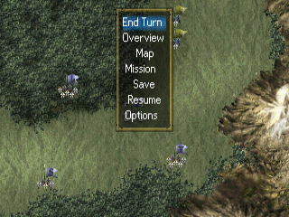
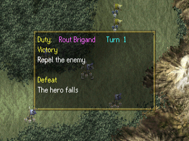
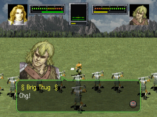

# Söldnerschild Special — English Translation

A fan translation of **Söldnerschild Special** (ゼルドナーシルト スペシャル, Koei, 1998) for the
PlayStation into English. It is a fantasy tactical RPG set on the continent of Liguria: the
orphan Ein joins Steindorf's Tigre Mercenaries after the Blood Mist Mercenaries raid his home.
Between missions he takes jobs from the Guild and the seven powers of the continent, visits
towns, hires and equips his men, and fights battles on the map, melees and duels. The game was
only released in Japan.

> **This is a full machine translation.** All of the game's text was translated from
> Japanese by an AI model, not by a human translator, and it has not been
> proofread by a fluent Japanese speaker. Expect occasional mistranslations, awkward
> phrasing and inconsistent terms. Corrections are welcome.

> **This is a beta.** All of the game's text is in English, but only the opening, the castle
> menus, the first town and the first battle have been played. Most missions, jobs and the
> endings have not been seen on screen. Expect some text that is squeezed, cut short or wrapped
> oddly later on.

This repository contains the English text and the tools that build the patch.
It does **not** contain the game, any of its data, or the Japanese script — you need
your own copy of the game.

## Screenshots

| | | |
|:-:|:-:|:-:|
|  |  |  |
| Title | Naming the hero | Choosing a unit type |
|  |  |  |
| Dialogue | Commanders | Items |
|  |  |  |
| Battle menu | Mission goals | Melee |

## What's translated

- All dialogue and narration: the voiced prologue, towns, shops, the Guild, church and castles,
  every mission, the character biographies and the endings
- All names of people, nations, mercenary companies, knightly orders and towns
- Menus, status and battle screens, items and their descriptions, classes, spells and special
  moves, Guild job descriptions, mission goals and battle choices, save and memory card
  messages (the memory card title is in English too)
- English name entry for the hero (letters instead of kana, 10 letters per name)
- Graphics, drawn at build time with original English lettering: the building labels and town
  names of the town maps, the town plates and date plate of the world map, and the battle
  banners (TURN, SUCCESS! / FAILED..., VICTORY / DEFEAT / DRAW)
- A proportional English font (original drawings) with word wrap

Long labels are shortened where the game's boxes are too small (for example "Inf.",
"Sword Cmdr", "Mor.").

## Applying the patch (players)

You need:

- **Your own copy of the Japanese disc as a disc image** (serial `SLPS-01319`): one `.bin` file
  and a `.cue` file. The patch does not contain the game.
- **A patching program.** [Delta Patcher](https://github.com/marco-calautti/DeltaPatcher) is
  free and needs no installation.
- **A PlayStation emulator.** The patch was tested in [DuckStation](https://www.duckstation.org/).

Steps:

1. **Download the patch.** Get `Soeldnerschild_Special_English_v<version>.zip` from the
   [Releases page](https://github.com/damon-daemon/soeldnerschild-special-english/releases)
   and unzip it. Inside are the patch (`.xdelta`), a `.cue` file and a README.txt.
2. **Copy the disc image.** Make a copy of your `.bin` file and give the copy exactly this
   name, with the version number of the zip you downloaded (for example `v0.9.0`):

   `Soeldnerschild Special (English v<version>).bin`

   Keep the original file as it is.
3. **Patch the copy.** Open Delta Patcher. Under **Original file** choose the copy you just
   made, under **XDelta patch** choose the `.xdelta` file from the zip, and click
   **Apply patch**.

   If it reports a checksum error, your disc image is not the one the patch was made for:
   compare it with the table below.
4. **Put two files in one folder:** the patched `.bin` and
   `Soeldnerschild Special (English v<version>).cue` from the zip.
5. **Play.** Open that `.cue` file in your emulator.

If the emulator says it cannot find a file, the name in step 2 does not match exactly.

### Is my disc image the right one?

The patch fits an unmodified image of the Japanese disc (`Soeldnerschild Special (Japan).bin`):

| | |
|---|---|
| Size  | 251,659,296 bytes |
| CRC32 | `A5AB4CDB` |
| MD5   | `7a2c8be7835c2e9297f762e3a2bae132` |
| SHA-1 | `d506e24da6e1772c61d2b9b67a89ad7b698747c9` |

### Command line

Instead of Delta Patcher (steps 2 and 3) you can use `xdelta3`:

```
xdelta3 -d -s "Soeldnerschild Special (Japan).bin" soeldnerschild_en_v<version>.xdelta "Soeldnerschild Special (English v<version>).bin"
```

## Building from source

Requirements: Python 3.10+ (standard library only), `xdelta3` (for the patch file).

```
cp "/path/to/Soeldnerschild Special (Japan).bin" soeldnerschild.bin
python3 tools/setup.py      # checks the disc, extracts its files to extract/, dumps the script
python3 tools/build.py      # writes build/soeldnerschild_en.bin (+ .cue) and the .xdelta
```

`script/`, `extract/` and `build/` hold data from your disc and are never committed.
`python3 tools/package.py <version>` then writes the release zip to `release/`.
No disc data is ever packaged. `requirements.txt` lists the packages of the development
helpers in `tools/dev/` only.

## Repository layout

| Path | Contents |
|---|---|
| `tl/msg/` | English for the dialogue file `MESSAGE.DAT`, by block and string number |
| `tl/names/` | People's names and speaker titles |
| `tl/progstr/` | English for strings in the game program, by address |
| `tl/tables/` | English for the program's record tables (items, classes, towns, spells ...) |
| `tl/datatext/` | Guild job descriptions (`JOBDATA.DAT`), mission goals and battle choices (`BEVENT.DAT`) |
| `tools/setup.py`, `tools/build.py` | Check the disc and extract; build the patched disc and the patch |
| `tools/msg.py`, `tools/tl.py` | Dialogue file format; translation checks, box measuring |
| `tools/iso.py` | Disc image |
| `tools/names.py`, `tools/progstr.py`, `tools/tables.py`, `tools/datatext.py` | Names, program strings, record tables, data file texts |
| `tools/vwf.py`, `tools/pixfont.py`, `tools/asm.py` | Proportional font and word wrap; small MIPS assembler |
| `tools/exefix.py`, `tools/nameentry.py` | Small program fixes (memory card title, date, counts); English name entry |
| `tools/gfx.py`, `tools/gfxbattle.py` | Redrawn graphics (town maps, plates, battle banners) |
| `tools/package.py` | Makes the release zip |
| `tools/dev/`, `tools/emu/` | Development helpers (disassembly, DuckStation automation) |
| `docs/screenshots/` | README screenshots |

## Known issues

- The title logo (with its katakana subtitle) and the movies are unchanged. The voiced prologue
  keeps its Japanese voices, with English text.
- The hero's name can only be entered in Latin letters, 10 per name.
- Some labels are abbreviated where the game's boxes are small, and some town names are
  shortened to 8 letters.
- Most missions and the endings have not been seen in play. Their text may overflow in places.

Tested in DuckStation only. Bug reports with a screenshot and where it happened are welcome.

## Credits

- Translation and hacking: [damon-daemon](https://github.com/damon-daemon)
- Söldnerschild Special © Koei Tecmo. This is an unofficial fan project, not affiliated with or
  endorsed by Koei Tecmo. Please support the official releases.

## License

The tools, fonts, documentation and English translation text in this repository
are released under the [MIT License](LICENSE). This covers only original work in
this repository: the game itself and all of its content (code, Japanese text,
graphics, audio) are copyright Koei Tecmo and are not included or licensed here.
